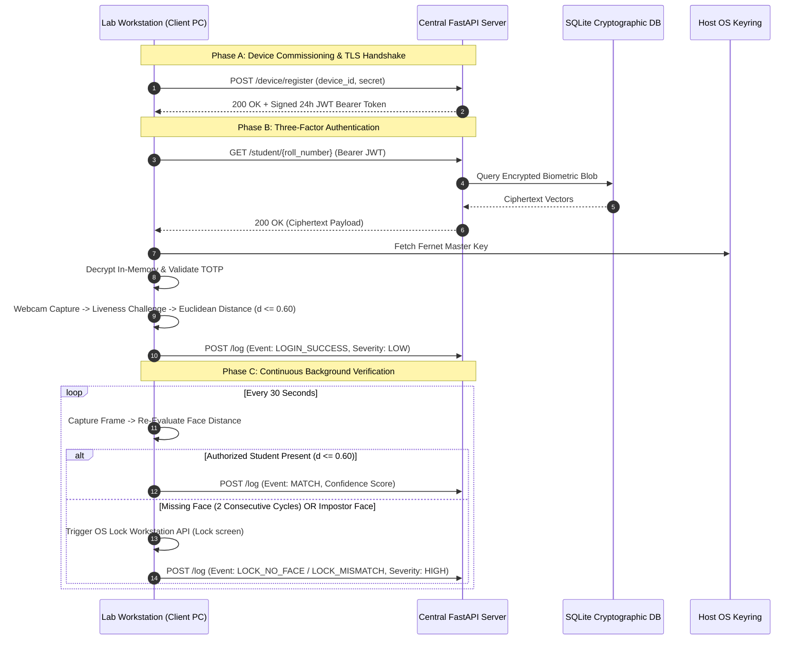

# 🛡️ Lab Face-Verified Access Lock System

[](https://www.python.org/)
[](https://fastapi.tiangolo.com/)
[](https://opencv.org/)
[](#4-threat-model--security-scoping)
[](https://opensource.org/licenses/MIT)

A high-assurance, **continuous multi-factor authentication (MFA)** and session governance system engineered to eliminate **proxy logins, session abandonment, and terminal hijacking** in institutional computer laboratories.

Built for standard commodity webcams and x86_64 lab PCs, the system combines **Three-Factor Authentication (Roll Number + TOTP + Facial Liveness)** with a **fail-closed background daemon** that continuously verifies student physical presence every 30 seconds.

---

## 🎥 System Demo Preview

```text
+-----------------------------------------------------------------------------------------+
|                               [DEMO VIDEO / GIF PLACEHOLDER]                           |
|                                                                                         |
|  1. Student Enrolls (CLI + Webcam + TOTP QR)     ==> Encrypted vector stored in DB     |
|  2. 3-Factor Login (Roll No -> Face Match -> TOTP -> Randomized Liveness Challenge)     |
|  3. Desktop Unlocks & Continuous Daemon Engages  ==> Periodic checks every 30s          |
|  4. Student Steps Away (Absence Timeout)         ==> Workstation Auto-Locks             |
|  5. Rogue SQL Injection Simulated                ==> Hash Chain Detects Tampering       |
+-----------------------------------------------------------------------------------------+
*(Full viva demo recording available in repository release artifacts)*
```

---

## 📑 Table of Contents
1. [Core Features](#1-core-features)
2. [System Architecture](#2-system-architecture)
3. [Quick Start Guide](#3-quick-start-guide)
4. [Threat Model & Security Scoping](#4-threat-model--security-scoping)
5. [Privacy & DPDP Act 2023 Compliance](#5-privacy--dpdp-act-2023-compliance)
6. [Testing & Verification](#6-testing--verification)
7. [License](#7-license)

---

## 1. Core Features

- 🔐 **Three-Factor Authentication:** Requires Roll Number (Identity Claim), Google Authenticator RFC 6238 TOTP (Possession), and Facial Landmark Verification (Inherence).
- 👁️ **Continuous Zero-Trust Session Verification:** Background daemon evaluates presence and Euclidean distance every 30 seconds. If the user walks away or an impostor sits down, the desktop forcibly locks.
- 🤖 **Randomized Challenge-Response Anti-Spoofing:** Dynamic challenge (Blink, Open Mouth, Turn Left, Turn Right) within a 4.0s window, actively cross-verifying that the face moving is the enrolled student.
- 🔒 **Authenticated Encryption at Rest:** 128-dimensional biometric embeddings and TOTP secrets are encrypted using Fernet (AES-128-CBC + HMAC-SHA256).
- 🔑 **Host OS Keyring Enclave:** Master encryption keys are isolated in the host Operating System Credential Manager (Windows Credential Manager / macOS Keychain / Secret Service)—never hardcoded in code or databases (CWE-798 mitigated).
- 🌐 **Transport Layer Security (TLS/HTTPS):** End-to-end encrypted REST communication with per-device OAuth2 JWT bearer tokens.
- ⛓️ **Tamper-Evident SHA-256 Audit Logging:** Linear cryptographic hash chain anchored to a Genesis Hash. Retroactive modification of timestamps, events, or scores immediately breaks chain traversal.
- 🚪 **Anti-Tailgating Enforcement:** Camera frame detects observer counts; multiple faces (`len(faces) > 1`) trigger an instant screen lock to protect student privacy.
- 🚨 **Fail-Closed Security Posture:** Network dropouts, sensor disconnects, or crashed server processes immediately default to locked workstations.
- 🔔 **Real-Time Webhook Alerting:** Instant asynchronous alerts dispatched via Discord/Slack webhooks upon HIGH-severity security violations.

---

## 2. System Architecture



---

## 3. Quick Start Guide

### Step 1: Clone Repository & Create Virtual Environment
```bash
# Clone the repository
git clone https://github.com/Dipakshinde121/-Face-Verified-Access-Lock-System.git
cd -Face-Verified-Access-Lock-System

# Create virtual environment
python -m venv .venv
.\.venv\Scripts\activate   # Windows PowerShell / CMD
# source .venv/bin/activate # Linux / macOS

# Install pinned dependencies
pip install -r requirements.txt
```

### Step 2: Download Facial Landmark Predictor
Download dlib's 68-point landmark predictor model into the project root:
- Direct Download: [http://dlib.net/files/shape_predictor_68_face_landmarks.dat.bz2](http://dlib.net/files/shape_predictor_68_face_landmarks.dat.bz2)
- Extract the archive to obtain `shape_predictor_68_face_landmarks.dat`.

### Step 3: Generate Local TLS Certificates
```bash
python gen_cert.py
# Generates server/cert.pem and server/key.pem for secure HTTPS transport
```

### Step 4: Initialize OS Keyring Master Key
```bash
python setup_key.py
# Generates a random 256-bit Fernet master key and stores it securely in OS Keyring
```

### Step 5: Start the Central Server

**Option A: Running Directly with Python**
```bash
python -m uvicorn server.main:app --host 127.0.0.1 --port 8000 --ssl-keyfile server/key.pem --ssl-certfile server/cert.pem
# Server Swagger API Docs available at: https://127.0.0.1:8000/docs
```

**Option B: Running with Docker (Recommended for Central Lab Server)**
```bash
# Build and run containerized server in the background
docker compose up -d --build
# Or run the Windows batch script:
run_docker.bat
```

### Step 6: Provision Lab Workstation (Edge Client on Other PCs)

On any student or lab PC:
```bash
# 1-Click Automated Setup (creates .venv, installs dependencies, provisions device):
setup_client.bat

# Or manual provisioning:
python setup_device.py
# Provisions unique device_id and secret; caches active JWT token
```

### Step 7: Enroll Student & Test Login
```bash
# Enroll a student (CLI + Webcam Capture + TOTP QR code display)
python register.py

# Authenticate at Workstation (Roll Number + TOTP + Facial Liveness)
python login.py
```

### Step 8: Verify Audit Log Integrity
```bash
python log_viewer.py --verify-integrity
# Verifies the SHA-256 cryptographic chain across all historical audit entries
```

---

## 4. Threat Model & Security Scoping

### 🛡️ Defended Attacks (In-Scope)
- **Credential Sharing & Attendance Fraud:** Defeated by physical facial inherence paired with rotating TOTP.
- **Unattended Terminal Hijacking:** Defeated by continuous verification auto-locking within 60s of student absence.
- **Photo & Video Replay Attacks:** Defeated by randomized challenge-response liveness within 4.0s.
- **Shoulder Surfing / Piggybacking:** Defeated by automated multi-face lock policy (`len(faces) > 1`).
- **Database Exfiltration (Data-at-Rest):** Defeated by Fernet AES-128 ciphertext; keys isolated in OS Keyring.
- **Audit Log Tampering:** Defeated by SHA-256 linear hash chaining anchored to Genesis Hash.
- **Network Sniffing:** Defeated by TLS 1.2/1.3 and per-device OAuth2 JWT tokens.

### ⚠️ Explicit Limitations (Documented Out-of-Scope)
- **High-End 3D Silicone Masks:** Commodity 2D RGB webcams lack active infrared structured light; enterprise anti-mask defense requires hardware IR sensors (e.g., Intel RealSense).
- **Physical Root Host Compromise:** An attacker with root/admin access to an unlocked running PC can dump volatile RAM.
- **Full Local Database Recomputation:** An insider with local SQLite write access could recompute hashes from the Genesis hash; enterprise deployments require remote RFC 3161 ledger anchoring.
- **Extreme Low-Light Conditions:** Insufficient ambient lighting degrades landmark detection, requiring proper laboratory lighting.

---

## 5. Privacy & DPDP Act 2023 Compliance

This system adheres to the core tenets of India's **Digital Personal Data Protection (DPDP) Act 2023**:
- **Zero Raw Image Retention:** Camera frames are strictly processed in volatile RAM and immediately discarded. No video or photos are saved to disk.
- **Storage Limitation & Encryption:** Only 128-dimensional floating arrays are stored, encrypted with authenticated Fernet AES-128.
- **Purpose Limitation:** Biometric embeddings are strictly utilized for session authorization and never shared with external services.
- **Explicit Consent:** Student onboarding requires voluntary input, clear privacy notices, and physical QR scan enrollment.

---

## 6. Testing & Verification

Run the automated integration and liveness test suites:
```bash
# Run Defense-in-Depth Integration Test Suite (FastAPI TestClient + Crypto Parity + Tamper Detection)
python test_integration.py

# Run Liveness Identity Verification Mock Test Suite
python test_liveness_identity.py
```

---

## 7. License

This project is licensed under the **MIT License** - see the [LICENSE](LICENSE) file for details.

### Why the MIT License?
The MIT License was chosen because it allows educational institutions, academic researchers, and students to freely audit, inspect, reproduce, and extend this cybersecurity framework without restrictive commercial barriers, while explicitly disclaiming warranty and liability for experimental research use.
