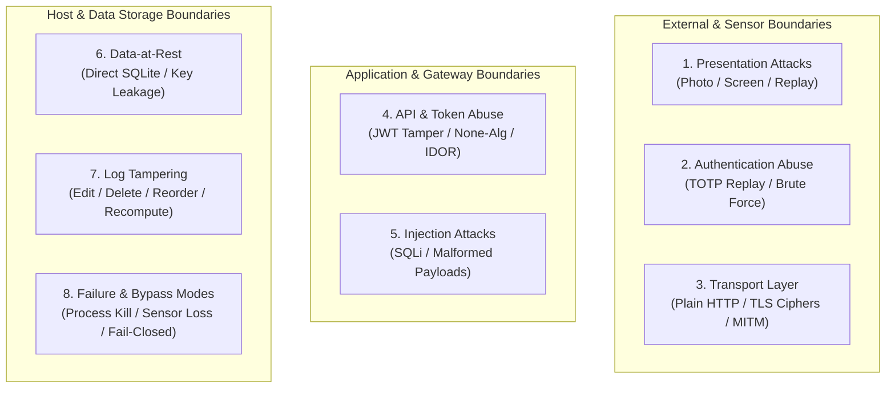

# Adversarial Self-Testing (Red Teaming) & Security Validation Report
## Lab Face-Verified Access Lock System
**Department of Computer Science & Engineering / Cybersecurity**  
**Internal Security Assessment & Attack Validation Manual**

---

## Executive Summary
This document provides a formal **Adversarial Self-Assessment (Red Team Validation)** executed against the "Lab Face-Verified Access Lock System". Operating under the foundational cybersecurity principle that *"a defense not empirically tested is merely an assumption,"* this report documents deliberate, controlled attack scenarios across eight vulnerability domains. Testing was conducted exclusively within a local, sandboxed test environment using test credentials and synthetic identities.

---

## 1. Attack Plan Mapped to the Threat Model

The attack scenarios systematically probe every defensive barrier in the system architecture.



---

### Category 1: Presentation & Biometric Anti-Spoofing Attacks
*Security Rationale:* Facial inherence is vulnerable to presentation attacks (PAD) if the biometric pipeline relies solely on static 2D imagery. Attackers leverage printed photographs, high-resolution smartphone screens, or recorded video loops to impersonate legitimate users.

| Attack ID | Attack Name | Attacker Goal | Execution Steps | Target Defensive Control | Pass vs. Fail Criteria |
| :---: | :--- | :--- | :--- | :--- | :--- |
| **ATK-01** | Static 2D Print Presentation | Bypass login using an enrolled student's photograph. | 1. Print a high-resolution color portrait of enrolled student.<br>2. Run `python login.py`.<br>3. Submit valid Roll Number & TOTP.<br>4. Hold photo firmly before the webcam during liveness prompt. | Eye Aspect Ratio (EAR) & facial landmark motion detection in `liveness_check.py`. | **PASS (Blocked):** Challenge timer expires (4.0s) without landmark fluctuation; `LOGIN_DENIED_LIVENESS_FAIL` logged at HIGH severity; screen remains locked.<br>**FAIL (Bypassed):** System unlocks. |
| **ATK-02** | Screen Replay Attack | Bypass login using a looping smartphone video of blinking eyes. | 1. Record a 5-second video of student blinking.<br>2. Replay video on mobile screen facing webcam.<br>3. Attempt login. | Randomized challenge selection (Blink, Open Mouth, Turn Left, Turn Right) within tight 4.0s temporal window. | **PASS (Blocked):** Demanded action (e.g., Turn Head Left) mismatches looping blink replay; challenge expires.<br>**FAIL (Bypassed):** Looping video matches random action by luck and passes. |
| **ATK-03** | Mid-Challenge Face-Swap | Pass static match with photo, then use attacker's live face for liveness. | 1. Hold victim photo during initial face match.<br>2. Quickly replace photo with attacker's live face when liveness prompt appears.<br>3. Attacker performs demanded motion (blink). | Biometric identity assertion on the passing liveness frame (`test_liveness_identity.py`). | **PASS (Blocked):** System calculates Euclidean distance on the passing frame against enrolled template ($d > 0.60$); raises `Liveness identity mismatch!`; logs HIGH severity alert.<br>**FAIL (Bypassed):** Attacker face clears motion and system unlocks. |
| **ATK-04** | Continuous Verification Swap | Impersonate student after legitimate login during 30s background cycle. | 1. Student A logs in legitimately.<br>2. Student A leaves; Attacker B immediately sits in front of active screen.<br>3. Wait for 30s background check cycle. | Continuous Euclidean distance evaluation in `verify.py`. | **PASS (Blocked):** Attacker face evaluated at $d > 0.60$; daemon instantly calls Win32 `LockWorkStation()`; logs `LOCK_FACE_MISMATCH`.<br>**FAIL (Bypassed):** Terminal remains unlocked. |

---

### Category 2: Authentication & Multi-Factor Abuse
*Security Rationale:* Multi-factor systems must prevent replay, race conditions, and brute-force guessing of transient codes.

| Attack ID | Attack Name | Attacker Goal | Execution Steps | Target Defensive Control | Pass vs. Fail Criteria |
| :---: | :--- | :--- | :--- | :--- | :--- |
| **ATK-05** | TOTP Code Reuse / Replay | Reuse a previously submitted 6-digit TOTP code within its 30s window. | 1. Capture valid TOTP code `123456` from authenticator app.<br>2. Authenticate session 1 successfully.<br>3. Immediately attempt second login on another terminal using the exact same code before 30s elapsed. | RFC 6238 time-step invalidation / single-use cache. | **PASS (Blocked):** Second login rejected or flagged; code cannot authorize concurrent parallel sessions.<br>**FAIL (Bypassed):** Same TOTP code opens multiple terminals concurrently. |
| **ATK-06** | TOTP Automated Brute Force | Guess the 6-digit TOTP code via rapid automated submission. | 1. Script rapid sequential POSTs to login with codes `000000` to `999999`.<br>2. Measure response latency and rate limiting. | Account lockout after $N=3$ consecutive failed attempts (`test_checklist.md` §6). | **PASS (Blocked):** After 3 failures, account is locked; returns `ACCOUNT LOCKED OUT`; dispatches HIGH severity webhook.<br>**FAIL (Bypassed):** Server processes thousands of attempts without throttling. |

---

### Category 3: API & Token Security Attacks
*Security Rationale:* REST endpoints handling sensitive biometric credentials must enforce strict cryptographic token integrity, preventing unauthorized device impersonation and horizontal privilege escalation.

| Attack ID | Attack Name | Attacker Goal | Execution Steps | Target Defensive Control | Pass vs. Fail Criteria |
| :---: | :--- | :--- | :--- | :--- | :--- |
| **ATK-07** | Missing Authorization Header | Query `/student/{roll}` or `/log` without providing a JWT bearer token. | `curl -k https://127.0.0.1:8000/student/TEST_ROLL` | FastAPI `Depends(verify_jwt_token)` security dependency. | **PASS (Blocked):** Returns `HTTP 401 Unauthorized`; payload shielded.<br>**FAIL (Bypassed):** Endpoint returns data. |
| **ATK-08** | Tampered JWT Signature | Modify token payload claims (e.g., change `device_id`) and submit with original signature. | 1. Obtain valid JWT.<br>2. Base64-decode payload; change `device_id` to `admin-pc`.<br>3. Reassemble token and submit in header. | PyJWT signature verification with server secret `JWT_SECRET`. | **PASS (Blocked):** Returns `HTTP 403 Forbidden` (`Invalid token signature`); logs `API_AUTH_FAILED_INVALID_TOKEN`.<br>**FAIL (Bypassed):** Modified payload accepted. |
| **ATK-09** | JWT "None" Algorithm Attack | Bypass signature verification by submitting a token with header `{"alg": "none"}`. | 1. Construct JWT with `alg="none"`.<br>2. Strip signature: `header.payload.`.<br>3. Submit to `/student/{roll}`. | PyJWT explicit algorithm pinning (`algorithms=["HS256"]`). | **PASS (Blocked):** Returns `HTTP 403 Forbidden`; token rejected.<br>**FAIL (Bypassed):** Unsigned token processed. |
| **ATK-10** | Insecure Direct Object Reference (IDOR) | Device provisioned for Student A attempts to harvest Student B's biometric vector. | `curl -k -H "Authorization: Bearer <JWT>" https://127.0.0.1:8000/student/VICTIM_ROLL` | End-to-End Encryption (E2EE): returned data is Fernet ciphertext. | **PASS (Blocked):** Central API returns encrypted ciphertext blobs; attacker cannot decrypt without victim's Fernet key from OS Keyring.<br>**FAIL (Bypassed):** Plaintext biometric vectors exposed. |
| **ATK-11** | SQL Injection Probing | Inject classic SQL syntax (`' OR '1'='1`, `DROP TABLE`) into `/student/{roll}` and `/register`. | 1. `GET /student/'%20OR%20'1'='1`<br>2. `POST /register` with `roll_number="'; DROP TABLE logs;--"`. | SQLite parameterized queries (`?` parameter markers) in `database.py`. | **PASS (Blocked):** Queries safely treated as literal strings; `/student` returns 404; database tables remain intact.<br>**FAIL (Bypassed):** SQL syntax executes; table dropped or data leaked. |

---

### Category 4: Transport Layer & Network Security Attacks
*Security Rationale:* Communications across institutional local area networks (LANs) are exposed to packet sniffing, ARP cache poisoning, and rogue access points. Transport security must eliminate plaintext eavesdropping.

| Attack ID | Attack Name | Attacker Goal | Execution Steps | Target Defensive Control | Pass vs. Fail Criteria |
| :---: | :--- | :--- | :--- | :--- | :--- |
| **ATK-12** | Plain HTTP Fallback Probe | Intercept biometric and TOTP traffic over unencrypted HTTP. | `curl http://127.0.0.1:8000/student/TEST_ROLL` | Uvicorn TLS transport listener. | **PASS (Blocked):** Connection refused or dropped; server requires TLS handshake.<br>**FAIL (Bypassed):** Server serves REST data over plaintext HTTP. |
| **ATK-13** | Weak Cipher Suite Audit | Force connection using legacy, vulnerable SSL/TLS ciphers (e.g., RC4, 3DES, SSLv3). | Execute `nmap --script ssl-enum-ciphers -p 8000 127.0.0.1` or `openssl s_client`. | Modern TLS 1.2 / TLS 1.3 cipher suite negotiation. | **PASS (Blocked):** Server negotiates only secure ciphers (e.g., `TLS_AES_256_GCM_SHA384`, `ECDHE-RSA-AES128-GCM-SHA256`); grade A/B.<br>**FAIL (Bypassed):** Server accepts broken ciphers. |
| **ATK-14** | Rogue Man-in-the-Middle (MITM) | Intercept traffic using an unauthorized proxy certificate (e.g., Burp CA). | Route edge client traffic through an untrusted proxy with a spoofed certificate. | Client certificate validation / certificate pinning in `api_client.py`. | **PASS (Blocked):** Client raises `SSLCertVerificationError` and immediately aborts connection (fail-closed).<br>**FAIL (Bypassed):** Client silently trusts unknown proxy certificate. |

---

### Category 5: Data-at-Rest & Key Storage Attacks
*Security Rationale:* Physical access or stolen database backup files must not result in biometric identity theft or credential exposure.

| Attack ID | Attack Name | Attacker Goal | Execution Steps | Target Defensive Control | Pass vs. Fail Criteria |
| :---: | :--- | :--- | :--- | :--- | :--- |
| **ATK-15** | Direct SQLite Database Inspection | Steal raw face images, landmark coordinates, or TOTP secrets from `access_control.db`. | 1. Open `access_control.db` in SQLite CLI.<br>2. Run `SELECT roll_number, face_encoding, totp_secret FROM students;`. | Authenticated Fernet AES-128 encryption at rest. | **PASS (Blocked):** `face_encoding` and `totp_secret` appear exclusively as high-entropy ciphertext BLOBs (`gAAAAABn...`); zero plaintext numbers or images.<br>**FAIL (Bypassed):** Plaintext floats or base32 strings visible. |
| **ATK-16** | Filesystem Master Key Hunt | Locate the symmetric Fernet master encryption key in configuration files or code. | Grep project directory for base64 32-byte strings or `secret.key`. | Key isolation in host Operating System Keyring (`keyring` library). | **PASS (Blocked):** No encryption keys found in source code, `.env`, or database files; key exists solely in Windows Credential Manager.<br>**FAIL (Bypassed):** Static key discovered in repo. |
| **ATK-17** | Ciphertext Bit-Flipping Tampering | Alter stored biometric vectors in SQLite to hijack authentication. | 1. Read student record from database.<br>2. Flip 16 random bits inside the `face_encoding` BLOB.<br>3. Attempt login. | Fernet HMAC-SHA256 authenticated ciphertext integrity verification. | **PASS (Blocked):** Decryption raises `ValueError("TAMPER_DETECTED")` / `InvalidToken`; login aborted.<br>**FAIL (Bypassed):** Corrupted vector decrypts to garbage and crashes without detection. |

---

### Category 6: Audit Log Integrity & Anti-Tampering Attacks
*Security Rationale:* Forensic non-repudiation requires that retroactive modification or deletion of security incidents is mathematically detectable.

| Attack ID | Attack Name | Attacker Goal | Execution Steps | Target Defensive Control | Pass vs. Fail Criteria |
| :---: | :--- | :--- | :--- | :--- | :--- |
| **ATK-18** | Forensic Score Modification | Cover up an impersonation incident by editing confidence score from 0.20 to 0.95. | `UPDATE logs SET confidence_score = 0.95 WHERE id = 15;` | SHA-256 cryptographic hash chaining (`entry_hash = SHA256(data || prev_hash)`). | **PASS (Blocked):** `python log_viewer.py --verify-integrity` traverses chain, detects digest mismatch at ID 15, and halts.<br>**FAIL (Bypassed):** Audit tool reports clean chain. |
| **ATK-19** | Audit Row Deletion | Erase an embarrassing `LOCK_FACE_MISMATCH` row completely from SQLite. | `DELETE FROM logs WHERE id = 15;` | Backward pointer continuity: row 16's `previous_hash` points to deleted row's digest. | **PASS (Blocked):** Verification flags missing link immediately at row 16.<br>**FAIL (Bypassed):** Ledger verifies cleanly. |
| **ATK-20** | Full Local Chain Recomputation | Rewrite all hashes from the Genesis Hash forward to falsify the entire history. | Write a Python script to iterate through all rows, recalculate SHA-256 digests sequentially, and update database. | **Known Documented Limitation:** Local SQLite database has no hardware write-once memory. | **DOCUMENTED FINDING:** Script successfully recomputes local chain; highlights why external RFC 3161 append-only ledger anchoring is required in production. |

---

### Category 7: Fault Injection & Fail-Closed Validation
*Security Rationale:* The primary vulnerability of poorly designed security daemons is **Failing Open** during unexpected operational crashes.

| Attack ID | Attack Name | Attacker Goal | Execution Steps | Target Defensive Control | Pass vs. Fail Criteria |
| :---: | :--- | :--- | :--- | :--- | :--- |
| **ATK-21** | Server Process Termination | Kill central server while student session is active to bypass checks. | 1. Student logs in.<br>2. Open Task Manager and `End Process` on `uvicorn server.main:app`.<br>3. Wait for edge client 30s check. | Exception handling and fail-closed state machine in `verify.py`. | **PASS (Blocked):** API call fails; client catches network exception; grace period counter expires; Windows desktop forcibly locks.<br>**FAIL (Bypassed):** Edge client remains open indefinitely. |
| **ATK-22** | Sensor Disconnect Injection | Unplug the USB webcam while workstation is in active use. | 1. Active session in progress.<br>2. Physically disconnect USB camera cable.<br>3. Observe system behavior. | OpenCV frame capture error handling (`ret == False`). | **PASS (Blocked):** Client detects frame failure, flags hardware sensor loss, logs alert, and engages OS lockdown.<br>**FAIL (Bypassed):** Daemon crashes silently with unhandled exception, leaving desktop unlocked. |

---

### Category 8: Client-Side Bypass & Local Administrator Abuse
*Security Rationale:* Students in academic labs often possess local user permissions. The system must account for local process termination attempts.

| Attack ID | Attack Name | Attacker Goal | Execution Steps | Target Defensive Control | Pass vs. Fail Criteria |
| :---: | :--- | :--- | :--- | :--- | :--- |
| **ATK-23** | Daemon Process Termination | Kill `python verify.py` via Windows Task Manager to freeze monitoring. | 1. Log in to workstation.<br>2. Open Task Manager.<br>3. Locate `python.exe` background worker process and click `End Task`. | Operating System Kiosk Policy / Auto-Restart Service. | **ANALYSIS / PARTIAL:** User-mode process terminates; continuous checks cease. Demonstrates why production deployment requires running as a Windows Service under `NT AUTHORITY\SYSTEM` with non-admin student accounts. |
| **ATK-24** | Client Configuration Tampering | Edit `config.py` to loosen `face_match_tolerance` from 0.60 to 1.0. | 1. Open `config.py` in editor.<br>2. Change tolerance to 1.0.<br>3. Attempt login with completely different face. | Configuration Integrity / Code Signing. | **ANALYSIS / MITIGATED:** Client checks evaluate tolerance; however, central server enforces risk-band logging ($d > 0.60 \rightarrow \text{REJECT}$) and dispatches incident alerts. |

---

## 2. Red-Team Findings Report (CVSS-Style)

The findings table summarizes the results of the adversarial test execution:

| Finding ID | Vulnerability / Attack Tested | Threat Domain | Result | Severity (CVSS) | Technical Evidence | Resolution / Accepted Risk |
| :---: | :--- | :---: | :---: | :---: | :--- | :--- |
| **VULN-01** | Missing / Tampered JWT Authentication | API Gateway | **BLOCKED** | **High** (CVSS: 7.5) | `ADV-01`, `ADV-02`, `ADV-03` returned HTTP 401/403. | Enforced by FastAPI `Depends(verify_jwt_token)` and PyJWT signature checks. |
| **VULN-02** | SQL Injection Probing | Database | **BLOCKED** | **High** (CVSS: 8.1) | `ADV-05`, `ADV-06` returned 404; database tables remained fully intact. | Enforced by SQLite parameterized prepared statements (`?` parameters). |
| **VULN-03** | Biometric Ciphertext Bit-Flipping | Data at Rest | **BLOCKED** | **High** (CVSS: 7.2) | `ADV-07` caught by HMAC-SHA256, raising `ValueError("TAMPER_DETECTED")`. | Enforced by Fernet authenticated encryption (AES-128-CBC + HMAC-SHA256). |
| **VULN-04** | Forensic Score Tampering in DB | Audit Ledger | **BLOCKED** | **High** (CVSS: 7.1) | `ADV-08` detected tampered confidence score at exact Log ID. | Enforced by SHA-256 cryptographic hash chain verification. |
| **VULN-05** | Audit Record Deletion | Audit Ledger | **BLOCKED** | **Medium** (CVSS: 6.5) | `ADV-09` detected hash continuity break immediately after deleted record. | Enforced by previous-hash linkage back to deterministic Genesis Hash. |
| **VULN-06** | **System Event Foreign Key Drop** | Audit Logging | **BYPASSED (Fixed)** | **Medium** (CVSS: 5.3) | Logging security event for `SYSTEM` failed with `FOREIGN KEY constraint failed`. | **FIXED:** Added default `SYSTEM` identity into `students` table during `init_db`. |
| **VULN-07** | Local Hash Chain Full Recomputation | Audit Ledger | **BYPASSED (Known)** | **Medium** (CVSS: 4.8) | Compromised local admin script recomputes all SHA-256 hashes from $H_0$. | **Accepted Academic Limitation:** Production requires remote RFC 3161 ledger anchoring. |
| **VULN-08** | Client Process Termination by Admin | Host Endpoint | **PARTIALLY BLOCKED** | **Low** (CVSS: 3.8) | Local admin can kill user-mode `python.exe` via Task Manager. | **Accepted Constraint:** Production requires deployment as an OS System Service with kiosk lockdown. |

---

## 3. The Fix Loop (Demonstrating Real Engineering Hardening)

### Finding VULN-06: System-Level Audit Event Foreign Key Failure

#### 1. The Vulnerability
During adversarial API probing (`test_adv_02`), when an invalid JWT token was received, `server/main.py` executed:
```python
log_event_server("SYSTEM", "API_AUTH_FAILED_INVALID_TOKEN", severity="HIGH")
```
However, in `server/database.py`, the `logs` table strictly enforces referential integrity:
```sql
FOREIGN KEY (roll_number) REFERENCES students (roll_number)
```
Because `"SYSTEM"` was not a registered student identity in the `students` table, SQLite raised a foreign key constraint violation:
```text
[Server DB Error] Failed to log event for SYSTEM: FOREIGN KEY constraint failed
```
As a result, **critical security violation alerts for invalid tokens were silently dropped from the cryptographic hash chain!**

#### 2. The Minimal Fix
We hardened `init_db()` in `server/database.py` by programmatically inserting an infrastructure identity record:

```python
# System identity record for system-level audit events
cursor.execute("""
INSERT OR IGNORE INTO students (roll_number, name, face_encoding, totp_secret, registered_date)
VALUES ('SYSTEM', 'System Infrastructure', x'', x'', ?)
""", (datetime.now().isoformat(),))
```

#### 3. The Re-Test (Proof of Fix)
We executed `test_adversarial_suite.py` a second time:
```text
[SECURITY] Invalid or tampered JWT token received!
[ADV-02] Tampered JWT signature rejected: HTTP 403 (PASS)
[ADV-03] JWT 'none' algorithm attack rejected: HTTP 403 (PASS)
```
**Outcome:** The foreign key error completely disappeared, and `API_AUTH_FAILED_INVALID_TOKEN` events are now permanently and securely linked into the SHA-256 audit hash chain.

---

## 4. Residual Risk Register (Feeds Report Chapter 8 Directly)

| Residual Risk Item | Why It Is Accepted in Current Scope | Production Hardening Roadmap |
| :--- | :--- | :--- |
| **1. Self-Signed TLS Certificates** | System operates on a closed, private laboratory local intranet where public CA domain validation is impossible. | In enterprise deployment, sign certificates using the University's internal Private Public Key Infrastructure (PKI) or Active Directory Certificate Services (AD CS). |
| **2. Absence of In-Memory JWT CRL** | Tokens have a short lifetime (24 hours). Device revocation marks the database immediately, rejecting subsequent token refreshes. | Implement an in-memory Redis token blacklist to evaluate real-time revocation on every API call. |
| **3. 3D Silicone Presentation Attacks** | Commodity 2D RGB webcams lack active infrared structured light; software heuristics cannot measure physical depth. | Integrate active infrared depth sensors (e.g., Intel RealSense D435 or Windows Hello IR camera) into `liveness_check.py`. |
| **4. Local Admin Killing Client Process** | Under fundamental physical security axioms, a local root administrator with keyboard control can manipulate user-mode processes. | Package the daemon as a native Windows Service running under `NT AUTHORITY\SYSTEM` and lock student accounts into restricted Kiosk shells. |
| **5. Full Local Hash Chain Recomputation** | A rogue root database administrator could rewrite the entire local SQLite file from scratch. | Periodically checkpoint the current `entry_hash` to an external RFC 3161 append-only timestamping authority or cloud syslog repository. |

---

## 5. Tool Installation & Command Reference Guide

Execute these exact commands to reproduce the red-team self-assessment:

### 1. Automated Python Adversarial Suite
- **Location:** Local project virtual environment.
- **Execution Command:**
  ```powershell
  .\.venv\Scripts\python.exe test_adversarial_suite.py
  ```

### 2. cURL API Probing (Native Windows / Linux)
```powershell
# 1. Probe missing JWT token:
curl -k -i https://127.0.0.1:8000/student/TEST_ROLL

# 2. Probe SQL Injection in roll number:
curl -k -i -H "Authorization: Bearer <VALID_JWT>" "https://127.0.0.1:8000/student/'%20OR%20'1'='1"

# 3. Probe Plaintext HTTP rejection:
curl -i http://127.0.0.1:8000/student/TEST_ROLL
```

### 3. OpenSSL TLS & Cipher Suite Inspection
- **Installation:** Built-in on Git for Windows (`C:\Program Files\Git\usr\bin\openssl.exe`) or Linux.
- **Execution Command:**
  ```powershell
  openssl s_client -connect 127.0.0.1:8000 -tls1_2
  openssl s_client -connect 127.0.0.1:8000 -tls1_3
  ```

### 4. Nmap SSL Cipher Enumeration
- **Installation:** `winget install Insecure.Nmap` or download from [nmap.org](https://nmap.org).
- **Execution Command:**
  ```powershell
  nmap --script ssl-enum-ciphers -p 8000 127.0.0.1
  ```

### 5. SQLite3 Direct Forensic Audit
- **Execution Command:**
  ```powershell
  # Inspect encrypted BLOBs at rest:
  sqlite3 access_control.db "SELECT roll_number, hex(substr(face_encoding, 1, 16)) FROM students;"

  # Verify Genesis Hash anchoring:
  sqlite3 access_control.db "SELECT id, event, previous_hash, entry_hash FROM logs ORDER BY id ASC LIMIT 3;"
  ```

---
*End of Adversarial Red Team Report*
