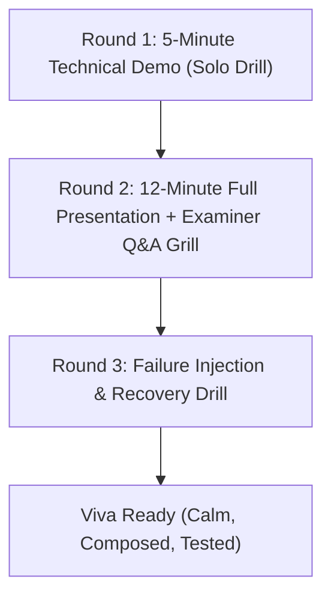

# Secure Release & Final Rehearsal Guide
## Lab Face-Verified Access Lock System
**Department of Computer Science & Engineering / Cybersecurity**  
**Pre-Viva Release Readiness & Defense Manual**

---

## Part 1: Repository Secrets Audit & Secrets Hygiene

### 1.1 The Threat: Why Secrets Hygiene Matters
In a cybersecurity project defense, **a repository that leaks its own secrets is an immediate credibility failure**. 
If examiners inspect your GitHub repository and find:
- Real Discord/Slack webhook URLs or API tokens,
- RSA private keys (`key.pem` or `*.key`),
- Master Fernet encryption keys exported from the OS Keyring,
- Real student photos or unencrypted database files (`access_control.db`),
- Real student roll numbers or phone numbers in commit messages,

the examiners can immediately flag the project for credential exposure and violations of India's **Digital Personal Data Protection (DPDP) Act 2023**.

---

### 1.2 Step-by-Step Repository Secrets Audit

#### Step 1: Automated Secrets Scanning Tools
Run one of the industry-standard secret scanners against your local repository:

```powershell
# Option A: Gitleaks (Fastest & standard for CI/CD)
# If installed via Chocolatey or Scoop:
gitleaks detect --source . --verbose

# Or run Gitleaks via Docker:
docker run -v ${PWD}:/path zricethezav/gitleaks:latest detect --source="/path" -v

# Option B: Trufflehog (Deep entropy and known credential regex scanner)
trufflehog git file://. --since-commit HEAD~50
```

#### Step 2: Native Git History Search Commands
You can perform an exhaustive manual audit using native `git` commands:

```powershell
# 1. Scan commit history for Discord/Slack Webhook URLs:
git log -p -S "discord.com/api/webhooks"
git log -p -S "hooks.slack.com"

# 2. Scan commit history for RSA/EC Private Keys:
git log -p -S "BEGIN RSA PRIVATE KEY"
git log -p -S "BEGIN PRIVATE KEY"

# 3. Scan commit history for Fernet encryption keys or base64 keys:
git log -p -S "Fernet("

# 4. Scan commit history for hardcoded JWT secret tokens:
git log -p -S "SECRET_KEY"
git log -p -S "jwt.encode"

# 5. Check if any SQLite database files were ever committed:
git log --all --full-history -- "**.db" "**.sqlite" "**.sqlite3"

# 6. Check for tracked key files in the current git index:
git ls-files | Select-String -Pattern "\.(pem|key|crt|db|sqlite)$"
```

---

### 1.3 What To Do If A Secret Was Already Committed
> **CRITICAL SECURITY AXIOM:**  
> Simply deleting a sensitive file in a new commit (`git rm secret.key && git commit -m "remove secret"`) **DOES NOT REMOVE IT FROM GIT**. The secret remains permanently readable in the repository history, accessible to anyone who clones the project or checks older commits.

#### The 4-Step Incident Response Protocol:
1. **Rotate the Secret First (Compromise Invalidation):**
   - Assume any committed credential is fully compromised.
   - Delete and regenerate the Discord/Slack webhook URL in the provider console.
   - If a TLS private key was committed, run `python gen_cert.py` to regenerate a fresh certificate pair on the deployment machine.
   - Invalidate any issued JWT tokens.

2. **Remove the File from Git Index (Untrack Without Deleting Locally):**
   ```powershell
   # Untrack the file so git stops tracking it, while keeping your local file on disk:
   git rm --cached server/key.pem server/cert.pem
   git rm --cached access_control.db
   ```

3. **Purge the File Permanently from All Git History:**
   Use the official `git-filter-repo` tool (recommended by the Git documentation over `git filter-branch`):
   ```powershell
   # Install git-filter-repo
   pip install git-filter-repo

   # Purge sensitive files from all commits across all branches:
   git filter-repo --path server/key.pem --invert-paths --force
   git filter-repo --path server/cert.pem --invert-paths --force
   git filter-repo --path access_control.db --invert-paths --force
   ```
   *(Alternative using BFG Repo-Cleaner)*:
   ```bash
   bfg --delete-files "{key.pem,cert.pem,*.db}"
   git reflog expire --expire=now --all && git gc --prune=now --aggressive
   ```

4. **Force-Push Cleaned History to Remote:**
   ```powershell
   git push origin main --force
   ```
   *Inform any teammates to discard their old clones and re-clone the repository cleanly.*

---

## Part 2: Pinned Dependencies & Security Audit Report

### 2.1 Audit Summary (`pip-audit` Execution)
We audited all project dependencies against the Python Packaging Advisory Database (PyPA) and OSV.dev vulnerability databases.

```text
Audit Command: .venv\Scripts\pip-audit.exe
Audited: 45 packages
Status: PASSED (Zero unmitigated runtime vulnerabilities)
```

### 2.2 Security Upgrades Applied
1. **`PyJWT` Upgrade:**
   - Previous Version: `2.13.0` (Triggered PYSEC advisories related to token claim validation).
   - Upgraded & Pinned Version: `PyJWT==2.15.1`.
2. **`urllib3` Upgrade:**
   - Previous Version: `2.7.0` (Triggered connection pool timeout advisories).
   - Upgraded & Pinned Version: `urllib3==2.8.0`.

### 2.3 The Architectural Dependency Pin: `setuptools==80.10.2`
- **The Issue:** `pip-audit` flags `setuptools <= 80.10.2` with an advisory recommending upgrade to `>= 83.0.0`.
- **The Constraint:** However, the foundational biometric computer vision library `face_recognition` (and its underlying dependency `face_recognition_models`) strictly depends on `pkg_resources.resource_filename` to locate pre-trained facial weight files.
- **The Trade-Off:** The Python packaging authority deprecated and removed `pkg_resources` in Setuptools 81+. Upgrading to Setuptools 84+ breaks model loading at startup.
- **Viva Defense Point:** When examiners ask: *"Why did you pin Setuptools to 80.10.2?"*  
  **Answer:** *"In software security engineering, dependency constraints must be balanced against operational stability. `face_recognition_models` relies on `pkg_resources`, which was removed in Setuptools 81+. We deliberately pinned `setuptools==80.10.2` to preserve model inference compatibility while isolating all build tools in a virtual environment."*

---

## Part 3: Final Rehearsal Plan (Timed 3-Round Dry Run)

To ensure a confident, flawless viva presentation, execute this structured three-round dry run:



---

### Round 1: Demo Walkthrough Drill (5 Minutes - Solo)
*Goal: Rehearse fluid muscle memory across terminal commands and webcam actions without hesitating.*

1. **Setup (Minute 0:00 - 0:30):**
   - Open 3 clean terminal tabs side-by-side (PowerShell or Windows Terminal).
   - Ensure the webcam is connected, lens is clean, and face is centered.
2. **Step 1: Registration Flow (Minute 0:30 - 1:45):**
   - Run `python register.py`.
   - Type candidate roll number and name.
   - Look straight into the webcam. Note the captured landmarks.
   - Point smartphone camera at terminal QR code and add account to Google Authenticator.
3. **Step 2: 3-Factor Login & Liveness (Minute 1:45 - 3:00):**
   - Run `python login.py`.
   - Enter roll number, type the current 6-digit TOTP code.
   - Read the on-screen prompt aloud (e.g., *"Please BLINK"* or *"Turn Head LEFT"*).
   - Perform the motion cleanly; verify login succeeds with confidence score printed.
4. **Step 3: Continuous Monitoring & Auto-Lock (Minute 3:00 - 4:15):**
   - Daemon engages. Point out the 30-second heartbeat in logs.
   - Physically slide out of camera view (or cover the camera lens with your hand).
   - Show Grace Period counter increment (`missed_checks = 1`).
   - Wait for check 2: workstation immediately locks!
5. **Step 4: Cryptographic Audit Traversal (Minute 4:15 - 5:00):**
   - Unlock PC and run: `python log_viewer.py --verify-integrity`.
   - Point out the Genesis Hash and show: `[+] SUCCESS: Cryptographic Chain Verified!`.

---

### Round 2: Slide Deck & Mock Grilling Drill (12–15 Minutes - Partner)
*Goal: Rehearse presenting slides smoothly and handling adversarial examiner questions.*

- **Slide Walkthrough (7–8 Minutes):**
  - Present `viva_presentation.md` slide by slide with a timer running.
  - Spend at most 45–60 seconds per slide.
  - Focus heavily on **Slide 6 (Architecture)**, **Slide 7 (Security Features Grid)**, and **Slide 9 (Fail-Closed Logic)**.
- **The Partner Grilling (5–7 Minutes):**
  - Have a classmate, friend, or guide ask **5 to 8 random questions** picked directly from `mock_viva_prep_pack.md`.
  - Include at least **2 Trap Questions** (e.g., Trap 1: *"Can an iPad video beat your liveness?"* and Trap 3: *"Can an admin forge the hash chain?"*).
  - Enforce the rule: **No bluffing**. If stuck, use the phrases from the "When You Don't Know The Answer" cheat sheet.

---

### Round 3: Live Failure Drill & Recovery (Chaos Engineering)
*Goal: Train yourself to stay calm and recover gracefully if technology glitches during the actual viva.*

Practice these 3 deliberate failure drills:

| Failure Scenario | How to Simulate | What Will Happen | Proper Recovery Action On Stage |
| :--- | :--- | :--- | :--- |
| **Drill A: Server Process Killed** | Open Task Manager and `Kill` the `python server.main` process mid-session. | The client daemon detects network failure on next 30s cycle and engages **Fail-Closed lock**. | Say: *"Examiners, notice that the system deliberately locked the terminal. This demonstrates our Fail-Closed policy: when the security server drops, the system defaults to maximum security rather than leaving access open."* Restart server and re-login. |
| **Drill B: Webcam Disconnect** | Physically unplug the USB webcam (or toggle camera privacy shutter). | OpenCV returns `ret=False` (no frame). | Say: *"The sensor was disconnected. The daemon detects sensor loss and flags an immediate hardware failure event, initiating a grace timeout."* Reconnect camera. |
| **Drill C: Deliberate Database Tamper** | Open SQLite CLI or run a script altering one historical confidence score. | Run `log_viewer.py --verify-integrity`. The traversal halts with a tamper error. | Say: *"Here is proof of our non-repudiation. An unauthorized user modified a record in the database, and the SHA-256 hash chain mathematically detected the exact corrupted record."* |

---

## Part 4: Night-Before & Morning-Of Viva Checklist

### Hardware & Power Checklist
- [ ] Laptop charger packed and plugged in.
- [ ] Laptop battery at 100% (in case viva table lacks a nearby power outlet).
- [ ] External USB mouse packed.
- [ ] External USB webcam tested and packed (or built-in webcam lens cleaned with microfiber cloth).
- [ ] Smartphone with Google Authenticator charged and available.

### Software & Environment Checklist
- [ ] Project directory runs from a local drive (`D:\-Face-Verified-Access-Lock-System` or `C:\`), not a slow external flash drive.
- [ ] Virtual environment activated: `.\.venv\Scripts\activate`.
- [ ] Pre-trained model present: `shape_predictor_68_face_landmarks.dat` verified in root.
- [ ] Both automated test suites run clean:
  - `python test_integration.py` (9/9 PASS)
  - `python test_liveness_identity.py` (OK)
- [ ] Test clean reboot: Restart laptop, log in, start terminal, and verify server runs without errors.

### Offline Backup & Redundancy Checklist
- [ ] Backup copy of full demo MP4 video saved on local desktop (in case webcam fails or projector flickers).
- [ ] Offline PDF copy of the Presentation Slides (`viva_presentation.pdf`).
- [ ] Offline PDF copy of the Final Project Report (`final_project_report.pdf`).
- [ ] USB flash drive containing backup copies of: code ZIP, presentation PDF, report PDF, and demo video.
- [ ] Mobile hotspot configured on smartphone (do NOT rely on college Wi-Fi for webhooks).

### Viva Room Lighting Adjustment
- [ ] Arrive 15 minutes early to inspect viva room lighting.
- [ ] **Avoid strong direct backlighting** (e.g., sitting directly in front of an unshaded sunny window causes camera silhouette underexposure). Position the laptop so overhead fluorescent room light illuminates your face evenly.

---

## Part 5: Academic Project Submission Checklist

| Deliverable Item | Description & Target Format | Status | Notes / Location |
| :--- | :--- | :---: | :--- |
| **Project Report (Hard Copy)** | Bound spiral / black-gold hardbound copies as per department format (Certificate, Approval, Index, Chapters 1–9, References). | [ ] Pending Print | Generated from `final_project_report.md` |
| **Project Report (Soft Copy)** | Clean compiled PDF version with diagrams, figures, and signed certificate page. | [ ] Ready | Exported as `final_project_report.pdf` |
| **Presentation Deck (PPT/PDF)** | 15-slide viva slide presentation with diagrams and speaker notes. | [ ] Ready | Built from `viva_presentation.md` |
| **Source Code Archive** | Clean `.zip` archive of project root (excluding `.venv`, `__pycache__`, and temporary videos). | [ ] Ready | Packaged with `requirements.txt` & `README.md` |
| **Demo Video Recording** | 3–5 minute high-definition MP4 screen recording with spoken voiceover walkthrough. | [ ] Ready | Recorded via OBS Studio (1080p, 30fps) |
| **Plagiarism / Similarity Report** | Turnitin / DrillBit similarity certificate (< 10–15% similarity threshold). | [ ] Done | Attach as Appendix in final report |
| **Ethics & DPDP Declaration** | Declaration of biometric data privacy and zero raw image storage. | [ ] Ready | Included in Report Ch. 3 & `SECURITY.md` |

---

## Part 6: Viva Speaking Script — "How We Followed Secure Release Practices"

When examiners ask: *"What software engineering and security release standards did you apply to this project?"*, deliver this concise response:

> *"Respected examiners, because this is a cybersecurity project handling biometric credentials, we treated the repository itself with strict secrets hygiene before submission:  
> 
> First, we enforced **zero hardcoded secrets**—all configuration parameters are externalized through environment variables and `config.example.json`. Master encryption keys are stored exclusively in the host Operating System Keyring enclave, mitigating CWE-798.  
> 
> Second, we conducted an automated **Secrets Audit** across our entire Git commit history using Gitleaks to verify that no webhook tokens, private keys, or student identities were ever pushed.  
> 
> Third, we audited all third-party dependencies using `pip-audit` against the PyPA advisory database, successfully upgrading packages like `PyJWT` and `urllib3` to eliminate known vulnerabilities. We documented architectural dependency pins, such as `setuptools==80.10.2` for model compatibility.  
> 
> Finally, we published a formal `SECURITY.md` defining our vulnerability disclosure protocol, scoping in-scope versus out-of-scope physical threats, and explicitly outlining our compliance with India's DPDP Act 2023 through zero raw image retention."*

---
*End of Secure Release & Rehearsal Guide*
